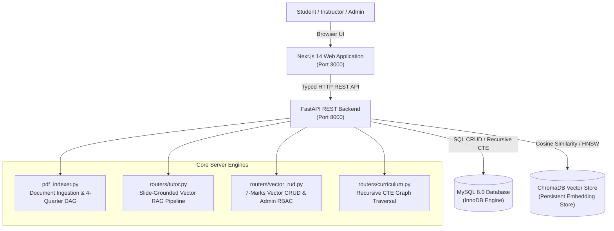

# AI Tutor & Dynamic Skill Tree: Project Viva & Technical Guide

This guide provides an end-to-end technical explanation of every component, algorithm, database query, and API endpoint in the codebase to facilitate presentation and viva examination.

---

## 1. System Architecture Overview



### Technology Stack Summary
- **Frontend**: Next.js 14 (App Router), TypeScript, Tailwind CSS, KaTeX (modular LaTeX math rendering), Lucide Icons.
- **Backend**: FastAPI (Python 3.11 ASGI framework), PyMySQL with `DictCursor`, Pydantic V2 schemas.
- **Relational DBMS**: MySQL 8.0 with InnoDB storage engine, autocommit management, ACID transaction boundaries, and Recursive Common Table Expressions (CTEs).
- **Vector Database**: ChromaDB PersistentClient with HNSW indexing and Cosine distance metric space (`hnsw:space: "cosine"`).

---

## 2. Relational Database Schema & Recursive CTEs

### 2.1 Core Relational Tables
1. **`USERS`**: Manages credentials and Role-Based Access Control (`student`, `instructor`, `admin`).
2. **`SUBJECTS`**: Stores course metadata (`subject_id`, `subject_key`, `subject_name`, `is_indexed`).
3. **`TOPICS`**: Stores concept vertices within each course (`topic_id`, `subject_id`, `topic_name`, `difficulty_level`, `visual_type`).
4. **`TOPIC_PREREQUISITES`**: Stores directed edges between topics (`topic_id`, `prereq_topic_id`, `importance_weight`).
5. **`TEXTBOOKS`**: Catalogs uploaded course materials (`textbook_id`, `subject_id`, `file_name`, `chroma_collection_name`, `chunk_count`).
6. **`LEARNING_SESSIONS`**: Tracks active student learning journeys with UUID identifiers.
7. **`CONVERSATION_LOGS`**: Records every user question and tutor answer turn with timestamps and stage context.
8. **`QUIZ_ATTEMPTS`**: Tracks student quiz evaluations and triggers mastery updates.

---

### 2.2 Recursive Common Table Expression 1: Ancestor Walk (Prerequisites)
**Endpoint**: `GET /api/curriculum/prerequisites/{topic_id}`  
**Purpose**: Traverses the prerequisite DAG backwards from a target topic to retrieve all direct and transitive ancestor prerequisites in topological order.

```sql
WITH RECURSIVE PrerequisiteChain AS (
    -- Anchor Member: Immediate direct prerequisites
    SELECT 
        tp.topic_id AS target_topic_id,
        tp.prereq_topic_id,
        t_pre.topic_name AS prereq_topic_name,
        t_pre.difficulty_level AS prereq_difficulty,
        tp.importance_weight,
        1 AS traversal_depth,
        CAST(t_pre.topic_name AS CHAR(1000)) AS learning_order_path
    FROM TOPIC_PREREQUISITES tp
    INNER JOIN TOPICS t_pre ON tp.prereq_topic_id = t_pre.topic_id
    WHERE tp.topic_id = %s

    UNION ALL

    -- Recursive Member: Transitive ancestor prerequisites
    SELECT 
        pc.target_topic_id,
        tp_parent.prereq_topic_id,
        t_ancestor.topic_name,
        t_ancestor.difficulty_level,
        tp_parent.importance_weight,
        pc.traversal_depth + 1,
        CONCAT(t_ancestor.topic_name, ' -> ', pc.learning_order_path)
    FROM PrerequisiteChain pc
    INNER JOIN TOPIC_PREREQUISITES tp_parent ON pc.prereq_topic_id = tp_parent.topic_id
    INNER JOIN TOPICS t_ancestor ON tp_parent.prereq_topic_id = t_ancestor.topic_id
)
SELECT 
    target_topic_id,
    prereq_topic_id,
    prereq_topic_name,
    prereq_difficulty,
    MAX(importance_weight) AS importance_weight,
    MIN(traversal_depth) AS traversal_depth,
    MIN(learning_order_path) AS learning_order_path
FROM PrerequisiteChain
GROUP BY target_topic_id, prereq_topic_id, prereq_topic_name, prereq_difficulty
ORDER BY traversal_depth ASC, importance_weight DESC;
```

**Viva Talking Point**:
- **Anchor Member**: Base case selecting direct rows matching `topic_id`.
- **Recursive Member**: Inductive step joining the temporary result set with `TOPIC_PREREQUISITES` on parent IDs.
- **Termination & Aggregation**: InnoDB halts recursion when no further parents are found. `MIN(traversal_depth)` handles diamond dependencies so each prerequisite appears at its earliest depth.

---

### 2.3 Recursive Common Table Expression 2: Descendant Walk (Unlocked Topics)
**Endpoint**: `GET /api/curriculum/unlocked/{topic_id}`  
**Purpose**: Traverses forward from a mastered topic to discover all downstream concepts unlocked across successive tiers.

```sql
WITH RECURSIVE UnlockedTopicsChain AS (
    -- Anchor Member: Topics immediately unlocked by mastering root topic
    SELECT 
        tp.topic_id AS unlocked_topic_id,
        t.topic_name AS unlocked_topic_name,
        t.difficulty_level,
        tp.prereq_topic_id AS root_mastered_id,
        1 AS unlock_tier
    FROM TOPIC_PREREQUISITES tp
    INNER JOIN TOPICS t ON tp.topic_id = t.topic_id
    WHERE tp.prereq_topic_id = %s

    UNION ALL

    -- Recursive Member: Downstream topics unlocked in higher tiers
    SELECT 
        tp_child.topic_id,
        t_child.topic_name,
        t_child.difficulty_level,
        utc.root_mastered_id,
        utc.unlock_tier + 1
    FROM UnlockedTopicsChain utc
    INNER JOIN TOPIC_PREREQUISITES tp_child ON utc.unlocked_topic_id = tp_child.prereq_topic_id
    INNER JOIN TOPICS t_child ON tp_child.topic_id = t_child.topic_id
)
SELECT 
    unlocked_topic_id,
    unlocked_topic_name,
    difficulty_level,
    MIN(unlock_tier) AS unlock_tier
FROM UnlockedTopicsChain
GROUP BY unlocked_topic_id, unlocked_topic_name, difficulty_level
ORDER BY unlock_tier ASC, difficulty_level ASC;
```

---

## 3. ChromaDB Vector Database RUD Implementation (7 Marks)

Every required Vector RUD operation is cleanly implemented and exposed via dedicated REST endpoints in `backend/routers/vector_rud.py`:

| Operation | HTTP Method | Endpoint | Implementation Function | Purpose |
| :--- | :--- | :--- | :--- | :--- |
| **CREATE** | `POST` | `/api/vector/chunk` | `add_vector_chunk()` | Inserts or upserts a single vector chunk with metadata. |
| **CREATE / INDEX** | `POST` | `/api/vector/upload` | `upload_and_index_document()` | Ingests PDF/TXT, chunks text, extracts topics, and batches embeddings into ChromaDB. |
| **READ (Search)** | `POST` | `/api/vector/search` | `search_vectors()` | Semantic Top-K similarity search using HNSW Cosine distance. |
| **READ (List)** | `GET` | `/api/vector/chunks/{subject_key}` | `list_subject_chunks()` | Lists chunks and metadata stored in the subject's collection. |
| **READ (Stats)** | `GET` | `/api/vector/stats/{subject_key}` | `get_collection_stats()` | Returns chunk count, HNSW configuration, and metadata. |
| **READ (Catalog)** | `GET` | `/api/vector/collections` | `list_collections()` | Lists all registered ChromaDB vector collections. |
| **UPDATE** | `PUT` | `/api/vector/update` | `update_vector_chunk()` | Updates text or metadata of an existing chunk, triggering automatic re-embedding. |
| **DELETE** | `DELETE` | `/api/vector/delete` | `delete_vector_chunks()` | Deletes individual chunks by ID or metadata filter. |
| **DELETE (Purge)** | `DELETE` | `/api/vector/clear-collection` | `clear_collection_vectors()` | Admin-protected reset of a single collection. |
| **DELETE (Wipe)** | `DELETE` | `/api/vector/clear-all` | `clear_all_vectors()` | Admin-protected complete purge of all collections and relational course tables. |
| **DELETE (Course)** | `DELETE` | `/api/vector/course/{id}` | `delete_course_and_vectors()` | Admin-protected deletion of an entire course and its vector collection. |

### Role-Based Access Control (RBAC) Enforcement
```python
def _verify_admin_privilege(user_id: Optional[int], role: Optional[str]):
    if role and role.strip().lower() == "admin":
        return
    if user_id:
        user = execute_one("SELECT role FROM USERS WHERE user_id = %s", (user_id,))
        if user and user["role"] == "admin":
            return
    raise HTTPException(status_code=403, detail="Forbidden: Admin privilege required.")
```

---

## 4. Pure Statistical 4-Part Skill Tree Generation (`pdf_indexer.py`)

### 4.1 Zero-Hardcoding Recurrence Algorithm
Instead of hardcoding domain dictionaries or university patterns, the system uses **cross-quarter statistical frequency analysis**:
1. Divides the document into 4 quarters: $Q_1, Q_2, Q_3, Q_4$.
2. Scans the top 4 lines of every page across each quarter.
3. If any line occurs across $\ge 2$ quarters, it is classified as a boilerplate template banner (such as a university header, author email, or faculty footer) and filtered out globally.
4. From the remaining candidates within each quarter, frequency counts determine the most representative concept title.
5. Injects 4 sequential topics into MySQL:
   - Part 1: Foundations (Tier 1)
   - Part 2: Core Principles (Tier 2)
   - Part 3: Intermediate Systems (Tier 3)
   - Part 4: Advanced Applications (Tier 4)
6. Establishes linear DAG edges in `TOPIC_PREREQUISITES`:
   $$\text{Part 1} \longrightarrow \text{Part 2} \longrightarrow \text{Part 3} \longrightarrow \text{Part 4}$$

---

## 5. Socratic Vector RAG Tutoring Pipeline (`tutor.py`)

### 5.1 Pipeline Stages
1. **Query Validation**: Resolves subject and active concept topic from relational database.
2. **Deterministic Cryptographic Solver**:
   If the student inputs a Hill Cipher problem (e.g. matrix key and ciphertext/plaintext), evaluates the linear algebra deterministically:
   - Encryption: $C = KP \bmod 26$
   - Determinant and Modular Multiplicative Inverse: $|K| \cdot |K|^{-1} \equiv 1 \pmod{26}$
   - Decryption: $P = K^{-1}C \bmod 26$
3. **Contextual Continuity Expansion**:
   If the student asks a short follow-up query (e.g., "how to solve", "give steps"), pulls the previous user turn from `CONVERSATION_LOGS` and prefixes the prompt to avoid context loss.
4. **Relational-Guided Semantic Search**:
   If relational filtering is enabled, queries ChromaDB with metadata filter:
   `where={"topic_id": {"$in": allowed_topic_ids}}`
   ensuring retrieved chunks are restricted to the active concept or its unlocked prerequisites.
5. **Slide-Grounded Synthesis**:
   Extracts slide titles, slide page numbers, mathematical formulas, and definitions.
   Renders attribution badges with cosine match percentages: `(Match: 87.4% · Slide Page 14)`.
6. **Relational Turn Logging**:
   Inserts query and answer turns into `CONVERSATION_LOGS`.

---

## 6. Key Viva Examination Questions & Model Answers

### Q1: What is the benefit of combining a relational database (MySQL) with a vector database (ChromaDB)?
> **Answer**: Relational databases excel at enforcing structured constraints, referential integrity, and graph relationships (such as prerequisite prerequisites and user sessions using ACID transactions). Vector databases excel at dense high-dimensional semantic search using approximate nearest neighbors (HNSW). By integrating both, our system executes **relational-guided vector RAG**: MySQL determines which prerequisite topics are pedagogically valid, and ChromaDB retrieves semantic slide chunks within that constrained subset.

### Q2: How does your Recursive CTE prevent infinite loops in cyclic dependencies?
> **Answer**: In our relational design, course curricula are strictly modeled as Directed Acyclic Graphs (DAGs). The recursive step joins `pc.prereq_topic_id = tp_parent.topic_id`, moving strictly upward to parent nodes. Furthermore, MySQL 8.0 enforces `cte_max_recursion_depth` (default 1000) as a database-level safeguard against cycles.

### Q3: How do you calculate similarity from ChromaDB distance?
> **Answer**: Our ChromaDB collections are initialized with `hnsw:space: "cosine"`. In cosine space, ChromaDB returns cosine distance $D_{\text{cosine}} = 1 - \cos(\theta)$. We compute cosine similarity as:
> $$\text{Similarity} = 1.0 - D_{\text{cosine}}$$
> A distance of 0.0 indicates identical vectors (100% similarity), while a distance of 1.0 indicates orthogonality.

### Q4: How is your skill tree generation dynamic without hardcoding?
> **Answer**: In `pdf_indexer.py`, the document is split into 4 quarters. The function `_extract_quarter_topics_pure` statistically computes line recurrence across quarters. Any line recurring across multiple quarters is flagged as a global template banner and ignored. The highest-frequency non-boilerplate candidate in each quarter becomes the title for that quarter's part, creating a 4-tier DAG completely dynamically for any uploaded syllabus or lecture deck.
