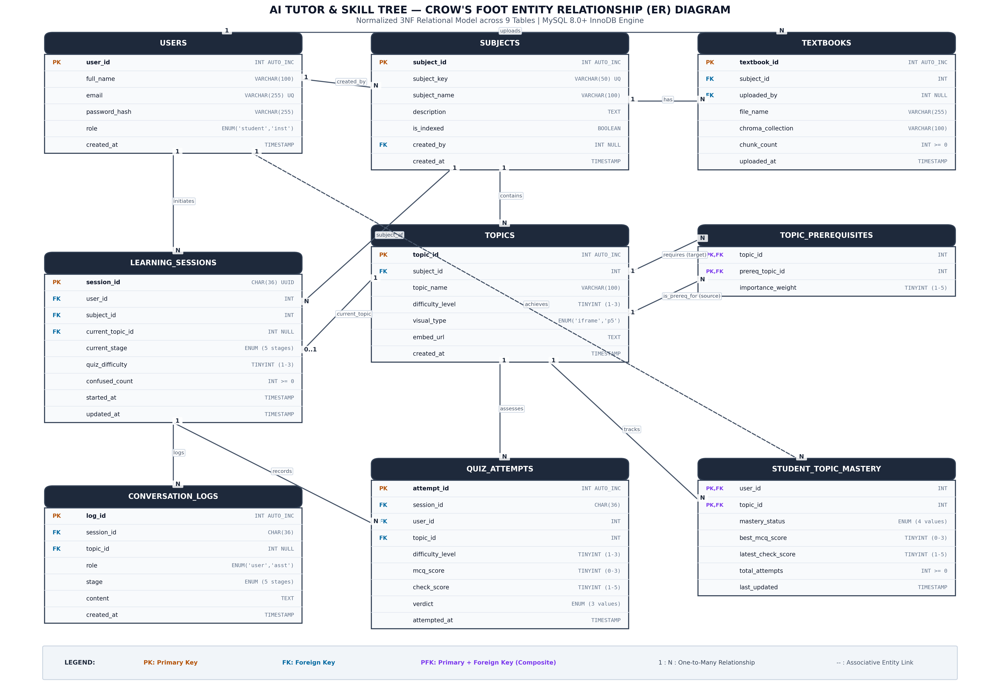
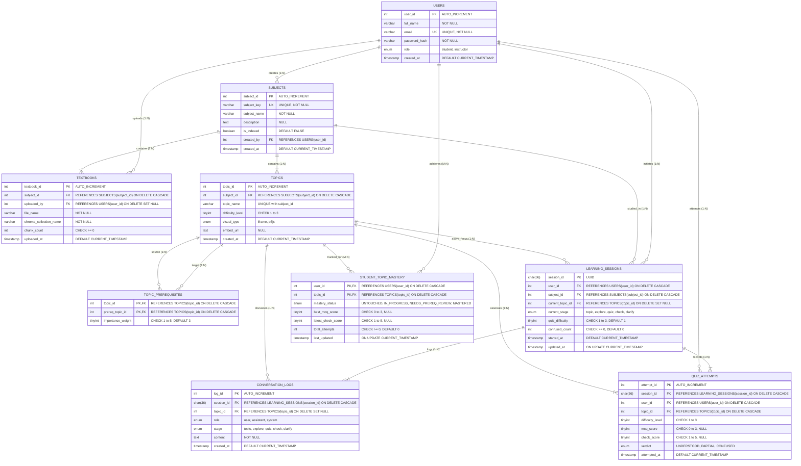

# AI Tutor & Skill Tree — Database Design Document
## Chapter 2: Entity-Relationship (ER) Diagram & Formal Relational Schema
**Course / Domain**: Database Management Systems (DBMS) / EdTech & Adaptive AI Learning  
**Target RDBMS**: MySQL 8.0+ (InnoDB Storage Engine) + Polyglot Vector Store (ChromaDB)  
**Evaluation Criteria**: Criterion 1 — Database Design (5 Marks)  
- **ER Diagram (Crow's Foot & Chen's Notations)**: 2 Marks  
- **Relational Schema with Keys, Relationships & Constraints**: 3 Marks  

---

## 1. Domain Overview & Problem Statement

Modern STEM education requires mastering foundational concepts before progressing to advanced topics (e.g., *Arrays* $\rightarrow$ *Trees* $\rightarrow$ *Dynamic Programming*; *MOSFET Physics* $\rightarrow$ *CMOS Inverter* $\rightarrow$ *Setup/Hold Timing Analysis*). Traditional Learning Management Systems (LMS) store flat progress records and fail to capture multi-hop dependencies or provide real-time remedial intervention when students stumble.

The **AI Tutor & Skill Tree** system implements an adaptive tutoring platform that:
1. Maps curriculum dependencies into a **Directed Acyclic Graph (DAG)** of prerequisite skills.
2. Tracks granular student learning sessions, turn-by-turn chat explanations, and assessment attempts.
3. Automatically computes topic mastery using database triggers and recommends personalized prerequisite remediation.
4. Integrates a dense vector store (ChromaDB) to ground conversational explanations in course textbook passages.

---

## 2. Conceptual Design & Entity Identification

The system models **9 normalized relational entities** (3NF) within the MySQL relational core:

| Entity Name | Entity Category | Description | Primary Key |
| :--- | :--- | :--- | :--- |
| **`USERS`** | Strong Entity | Student and instructor accounts with platform credentials and role RBAC. | `user_id` (INT) |
| **`SUBJECTS`** | Strong Entity | STEM curriculum domains (DSA, Digital VLSI, CS, Networks). | `subject_id` (INT) |
| **`TEXTBOOKS`** | Strong Entity | Syllabus textbook PDFs mapped to ChromaDB vector collections. | `textbook_id` (INT) |
| **`TOPICS`** | Strong Entity | Discrete pedagogical concepts with difficulty tiers and visual embed routes. | `topic_id` (INT) |
| **`TOPIC_PREREQUISITES`**| Associative / Recursive | Self-referencing M:N adjacency matrix modeling the prerequisite skill tree DAG. | `(topic_id, prereq_topic_id)` |
| **`LEARNING_SESSIONS`** | Strong Entity | Active multi-turn tutoring sessions managing the 5-stage tutoring loop. | `session_id` (CHAR(36) UUID) |
| **`CONVERSATION_LOGS`** | Weak (Child of Session)| Granular turn-by-turn dialogue messages across tutor and student. | `log_id` (INT) |
| **`QUIZ_ATTEMPTS`** | Associative / Transactional | Objective MCQ scores and comprehension check scores with verdict outcomes. | `attempt_id` (INT) |
| **`STUDENT_TOPIC_MASTERY`**| Associative Entity | Accumulated student topic competence, auto-updated via MySQL triggers. | `(user_id, topic_id)` |

---

## 3. Entity Relationships, Cardinalities & Participation

```
+----------------------------------------------------------------------------------------------------+
|                                    CARDINALITY & PARTICIPATION MATRIX                              |
+--------------------------+---------------------+-------------------+-----------------+-------------+
| Entity 1                 | Relationship        | Entity 2          | Cardinality     | Partic. E1  |
+--------------------------+---------------------+-------------------+-----------------+-------------+
| USERS (Instructor)       | Creates / Curates   | SUBJECTS          | 1 : N           | Partial (0) |
| SUBJECTS                 | Contains            | TEXTBOOKS         | 1 : N           | Total (1..N)|
| USERS (Instructor)       | Uploads             | TEXTBOOKS         | 1 : N           | Partial (0) |
| SUBJECTS                 | Contains            | TOPICS            | 1 : N           | Total (1..N)|
| TOPICS (Target)          | Requires Prereq     | TOPICS (Source)   | Recursive M : N | Partial (0) |
| USERS (Student)          | Initiates           | LEARNING_SESSIONS | 1 : N           | Partial (0) |
| SUBJECTS                 | Subject Under Study | LEARNING_SESSIONS | 1 : N           | Total (1..N)|
| TOPICS                   | Current Focus       | LEARNING_SESSIONS | 1 : N           | Partial (0) |
| LEARNING_SESSIONS        | Generates           | CONVERSATION_LOGS | 1 : N           | Total (1..N)|
| TOPICS                   | Referenced In       | CONVERSATION_LOGS | 1 : N           | Partial (0) |
| LEARNING_SESSIONS        | Records Attempt In  | QUIZ_ATTEMPTS     | 1 : N           | Total (1..N)|
| USERS (Student)          | Submits             | QUIZ_ATTEMPTS     | 1 : N           | Partial (0) |
| TOPICS                   | Evaluated In        | QUIZ_ATTEMPTS     | 1 : N           | Total (1..N)|
| USERS                    | Accumulates Mastery | TOPICS            | M : N           | Partial (0) |
+--------------------------+---------------------+-------------------+-----------------+-------------+
```

### Participation Constraints Analysis:
* **Total Participation (Double Line in Chen)**:
  - Every `TEXTBOOK` **must** belong to exactly one `SUBJECT`.
  - Every `TOPIC` **must** belong to exactly one `SUBJECT`.
  - Every `CONVERSATION_LOG` and `QUIZ_ATTEMPT` **must** belong to an active `LEARNING_SESSION`.
* **Partial Participation (Single Line in Chen)**:
  - A `USER` may exist without having uploaded a textbook (e.g. students or new instructors).
  - A foundational `TOPIC` (e.g. *Arrays & Pointers*) has **no** prerequisites.
  - A `LEARNING_SESSION` may temporarily have `current_topic_id = NULL` upon session completion.

---

## 4. Crow's Foot Entity-Relationship (ER) Diagram

### High-Resolution Architectural Graphic


### Formal Mermaid Crow's Foot Specification



---

## 5. Formal Relational Schema Specification

### Mathematical Schema Notation
*(Primary Keys are underlined; Foreign Keys are marked with superscripts $\text{FK}$)*

1. $\text{USERS}(\underline{\text{user\_id}}, \text{full\_name}, \text{email}, \text{password\_hash}, \text{role}, \text{created\_at})$
2. $\text{SUBJECTS}(\underline{\text{subject\_id}}, \text{subject\_key}, \text{subject\_name}, \text{description}, \text{is\_indexed}, \text{created\_by}^{\text{FK}}, \text{created\_at})$
3. $\text{TEXTBOOKS}(\underline{\text{textbook\_id}}, \text{subject\_id}^{\text{FK}}, \text{uploaded\_by}^{\text{FK}}, \text{file\_name}, \text{chroma\_collection\_name}, \text{chunk\_count}, \text{uploaded\_at})$
4. $\text{TOPICS}(\underline{\text{topic\_id}}, \text{subject\_id}^{\text{FK}}, \text{topic\_name}, \text{difficulty\_level}, \text{visual\_type}, \text{embed\_url}, \text{created\_at})$
5. $\text{TOPIC\_PREREQUISITES}(\underline{\text{topic\_id}}^{\text{FK}}, \underline{\text{prereq\_topic\_id}}^{\text{FK}}, \text{importance\_weight})$
6. $\text{LEARNING\_SESSIONS}(\underline{\text{session\_id}}, \text{user\_id}^{\text{FK}}, \text{subject\_id}^{\text{FK}}, \text{current\_topic\_id}^{\text{FK}}, \text{current\_stage}, \text{quiz\_difficulty}, \text{confused\_count}, \text{started\_at}, \text{updated\_at})$
7. $\text{CONVERSATION\_LOGS}(\underline{\text{log\_id}}, \text{session\_id}^{\text{FK}}, \text{topic\_id}^{\text{FK}}, \text{role}, \text{stage}, \text{content}, \text{created\_at})$
8. $\text{QUIZ\_ATTEMPTS}(\underline{\text{attempt\_id}}, \text{session\_id}^{\text{FK}}, \text{user\_id}^{\text{FK}}, \text{topic\_id}^{\text{FK}}, \text{difficulty\_level}, \text{mcq\_score}, \text{check\_score}, \text{verdict}, \text{attempted\_at})$
9. $\text{STUDENT\_TOPIC\_MASTERY}(\underline{\text{user\_id}}^{\text{FK}}, \underline{\text{topic\_id}}^{\text{FK}}, \text{mastery\_status}, \text{best\_mcq\_score}, \text{latest\_check\_score}, \text{total\_attempts}, \text{last\_updated})$

---

### Detailed Table Specifications with Constraints

#### Table 1: `USERS`
* **Purpose**: Authentication, authorization, and database role assignment.
* **Primary Key**: `user_id` (INT, AUTO_INCREMENT)
* **Candidate Keys**: `email` (UNIQUE)
* **Attributes**:
  - `full_name`: VARCHAR(100), NOT NULL
  - `email`: VARCHAR(255), UNIQUE, NOT NULL
  - `password_hash`: VARCHAR(255), NOT NULL (Bcrypt hash)
  - `role`: ENUM('student', 'instructor'), NOT NULL
  - `created_at`: TIMESTAMP, NOT NULL, DEFAULT CURRENT_TIMESTAMP

#### Table 2: `SUBJECTS`
* **Purpose**: Core engineering curriculum domains.
* **Primary Key**: `subject_id` (INT, AUTO_INCREMENT)
* **Candidate Keys**: `subject_key` (UNIQUE)
* **Foreign Keys**:
  - `created_by` $\rightarrow$ `USERS(user_id)` ON DELETE SET NULL
* **Constraints**:
  - `is_indexed`: BOOLEAN, NOT NULL, DEFAULT FALSE

#### Table 3: `TEXTBOOKS`
* **Purpose**: Maps uploaded textbooks to ChromaDB vector collections.
* **Primary Key**: `textbook_id` (INT, AUTO_INCREMENT)
* **Foreign Keys**:
  - `subject_id` $\rightarrow$ `SUBJECTS(subject_id)` ON DELETE CASCADE
  - `uploaded_by` $\rightarrow$ `USERS(user_id)` ON DELETE SET NULL
* **Domain Constraints**:
  - `CONSTRAINT chk_textbook_chunk_count CHECK (chunk_count >= 0)`

#### Table 4: `TOPICS`
* **Purpose**: Discrete curriculum concepts and visualizer routes.
* **Primary Key**: `topic_id` (INT, AUTO_INCREMENT)
* **Foreign Keys**:
  - `subject_id` $\rightarrow$ `SUBJECTS(subject_id)` ON DELETE CASCADE
* **Domain Constraints**:
  - `CONSTRAINT uq_subject_topic UNIQUE (subject_id, topic_name)`
  - `CONSTRAINT chk_topic_difficulty CHECK (difficulty_level BETWEEN 1 AND 3)`
  - `visual_type`: ENUM('iframe', 'p5js'), NOT NULL

#### Table 5: `TOPIC_PREREQUISITES`
* **Purpose**: Models the directed acyclic skill tree graph in relational 3NF.
* **Primary Key**: Composite `(topic_id, prereq_topic_id)`
* **Foreign Keys**:
  - `topic_id` $\rightarrow$ `TOPICS(topic_id)` ON DELETE CASCADE
  - `prereq_topic_id` $\rightarrow$ `TOPICS(topic_id)` ON DELETE CASCADE
* **Domain Constraints**:
  - `CONSTRAINT chk_no_self_prereq CHECK (topic_id <> prereq_topic_id)` (Prevents 1-node self loops)
  - `CONSTRAINT chk_importance_weight CHECK (importance_weight BETWEEN 1 AND 5)`

#### Table 6: `LEARNING_SESSIONS`
* **Purpose**: Manages multi-turn tutoring state machine and confusion threshold.
* **Primary Key**: `session_id` (CHAR(36), Client/FastAPI generated UUID)
* **Foreign Keys**:
  - `user_id` $\rightarrow$ `USERS(user_id)` ON DELETE CASCADE
  - `subject_id` $\rightarrow$ `SUBJECTS(subject_id)` ON DELETE CASCADE
  - `current_topic_id` $\rightarrow$ `TOPICS(topic_id)` ON DELETE SET NULL
* **Domain Constraints**:
  - `current_stage`: ENUM('topic', 'explore', 'quiz', 'check', 'clarify'), NOT NULL, DEFAULT 'topic'
  - `CONSTRAINT chk_session_difficulty CHECK (quiz_difficulty BETWEEN 1 AND 3)`
  - `CONSTRAINT chk_session_confused_count CHECK (confused_count >= 0)`

#### Table 7: `CONVERSATION_LOGS`
* **Purpose**: Stores dialogue turns for contextual history.
* **Primary Key**: `log_id` (INT, AUTO_INCREMENT)
* **Foreign Keys**:
  - `session_id` $\rightarrow$ `LEARNING_SESSIONS(session_id)` ON DELETE CASCADE
  - `topic_id` $\rightarrow$ `TOPICS(topic_id)` ON DELETE SET NULL
* **Domain Constraints**:
  - `role`: ENUM('user', 'assistant', 'system'), NOT NULL
  - `stage`: ENUM('topic', 'explore', 'quiz', 'check', 'clarify'), NOT NULL
  - `content`: TEXT, NOT NULL

#### Table 8: `QUIZ_ATTEMPTS`
* **Purpose**: Records quantitative quiz and qualitative check submissions.
* **Primary Key**: `attempt_id` (INT, AUTO_INCREMENT)
* **Foreign Keys**:
  - `session_id` $\rightarrow$ `LEARNING_SESSIONS(session_id)` ON DELETE CASCADE
  - `user_id` $\rightarrow$ `USERS(user_id)` ON DELETE CASCADE
  - `topic_id` $\rightarrow$ `TOPICS(topic_id)` ON DELETE CASCADE
* **Domain Constraints**:
  - `CONSTRAINT chk_attempt_difficulty CHECK (difficulty_level BETWEEN 1 AND 3)`
  - `CONSTRAINT chk_attempt_mcq_score CHECK (mcq_score BETWEEN 0 AND 3)`
  - `CONSTRAINT chk_attempt_check_score CHECK (check_score BETWEEN 1 AND 5)`
  - `verdict`: ENUM('UNDERSTOOD', 'PARTIAL', 'CONFUSED'), NULL

#### Table 9: `STUDENT_TOPIC_MASTERY`
* **Purpose**: Persistent student competence status, maintained automatically by triggers.
* **Primary Key**: Composite `(user_id, topic_id)`
* **Foreign Keys**:
  - `user_id` $\rightarrow$ `USERS(user_id)` ON DELETE CASCADE
  - `topic_id` $\rightarrow$ `TOPICS(topic_id)` ON DELETE CASCADE
* **Domain Constraints**:
  - `mastery_status`: ENUM('UNTOUCHED', 'IN_PROGRESS', 'NEEDS_PREREQ_REVIEW', 'MASTERED'), DEFAULT 'UNTOUCHED'
  - `CONSTRAINT chk_mastery_mcq_score CHECK (best_mcq_score BETWEEN 0 AND 3)`
  - `CONSTRAINT chk_mastery_check_score CHECK (latest_check_score BETWEEN 1 AND 5)`
  - `CONSTRAINT chk_mastery_total_attempts CHECK (total_attempts >= 0)`

---

## 6. Normalization Proofs (1NF $\rightarrow$ 2NF $\rightarrow$ 3NF)

### 1. First Normal Form (1NF)
* **Criteria**: Every column contains atomic (indivisible) values; no repeating groups or arrays.
* **Proof**:
  - Rather than storing an array of prerequisite IDs inside a `prerequisites` text column in `TOPICS`, we decomposed the relation into the associative table `TOPIC_PREREQUISITES`.
  - Rather than storing chat messages as a JSON array inside `LEARNING_SESSIONS`, each message turn is stored as an atomic row in `CONVERSATION_LOGS`.
  - All attributes are primitive scalar types (INT, VARCHAR, TIMESTAMP, ENUM). $\therefore$ **In 1NF**.

### 2. Second Normal Form (2NF)
* **Criteria**: Must be in 1NF, and every non-key attribute must be **fully functionally dependent** on the complete primary key (no partial functional dependencies on composite keys).
* **Proof**:
  - Tables with single-column primary keys (`USERS`, `SUBJECTS`, `TEXTBOOKS`, `TOPICS`, `LEARNING_SESSIONS`, `CONVERSATION_LOGS`, `QUIZ_ATTEMPTS`) automatically satisfy 2NF because partial dependencies can only occur when a PK is composite.
  - In `TOPIC_PREREQUISITES(topic_id, prereq_topic_id)`:
    - Primary Key: `(topic_id, prereq_topic_id)`
    - Non-key attribute: `importance_weight`
    - Functional Dependency: `(topic_id, prereq_topic_id) -> importance_weight`. The weight depends on the specific pair, not on `topic_id` alone. $\therefore$ No partial dependency.
  - In `STUDENT_TOPIC_MASTERY(user_id, topic_id)`:
    - Primary Key: `(user_id, topic_id)`
    - Non-key attributes: `mastery_status`, `best_mcq_score`, `latest_check_score`, `total_attempts`, `last_updated`.
    - All non-key attributes describe the performance of a specific student on a specific topic. None can be determined by `user_id` alone or `topic_id` alone. $\therefore$ **In 2NF**.

### 3. Third Normal Form (3NF)
* **Criteria**: Must be in 2NF, and no non-key attribute is transitively dependent on the primary key ($X \rightarrow Y$ and $Y \rightarrow Z$ where $X$ is PK).
* **Proof**:
  - In `TOPICS`: `topic_id -> subject_id`. We do **not** store `subject_name` or `subject_description` inside `TOPICS`; those reside in `SUBJECTS`. If we had stored `subject_name` in `TOPICS`, we would have had the transitive dependency: $\text{topic\_id} \rightarrow \text{subject\_id} \rightarrow \text{subject\_name}$.
  - In `QUIZ_ATTEMPTS`: `attempt_id -> session_id, user_id, topic_id, mcq_score, verdict`. We do not store `user_name` or `topic_name` in `QUIZ_ATTEMPTS`.
  - In `TEXTBOOKS`: `textbook_id -> subject_id, file_name, chroma_collection_name`. We do not duplicate course descriptions.
  - Every non-key attribute depends on "the key, the whole key, and nothing but the key". $\therefore$ **In 3NF**.

---

## 7. Viva Defense Defense Guide for Criterion 1

| Frequently Asked Viva Question | Strong Academic Answer |
| :--- | :--- |
| **Q1: Why is `TOPIC_PREREQUISITES` modeled as a recursive M:N table?** | *"A STEM curriculum is a Directed Acyclic Graph (DAG). An advanced topic (e.g. Dynamic Programming) can require multiple foundational topics (Recursion, Arrays), and a single foundation topic (Arrays) serves as a prerequisite for multiple downstream topics (Lists, BST, Graphs). A recursive M:N self-join table with `(topic_id, prereq_topic_id)` elegantly represents graph adjacency in 3NF and enables Recursive CTE traversal in SQL."* |
| **Q2: Why use `CHAR(36)` UUID for `session_id` instead of `AUTO_INCREMENT INT`?** | *"Tutoring sessions are created dynamically across client connections. Using client-generated UUIDv4 prevents ID enumeration attacks (where students could guess other active session IDs) and supports future distributed horizontal scaling without primary key auto-increment collisions."* |
| **Q3: What is the difference between `ON DELETE CASCADE` and `ON DELETE SET NULL` in your schema?** | *"`CASCADE` is used when the child entity cannot exist without its parent (e.g. deleting a `SUBJECT` cascades to delete all its `TOPICS` and `TEXTBOOKS`). `SET NULL` is used when the child entity must persist even if the referenced entity is deleted (e.g., if an instructor user is deleted from `USERS`, the subject and textbook records remain active with `created_by = NULL` and `uploaded_by = NULL` to avoid losing university course curriculum)."* |
| **Q4: Why is `STUDENT_TOPIC_MASTERY` maintained separately from `QUIZ_ATTEMPTS`?** | *"`QUIZ_ATTEMPTS` is an append-only transaction ledger recording every single attempt for audit history. `STUDENT_TOPIC_MASTERY` is an aggregate state table maintaining real-time competence (`MASTERED`, `NEEDS_PREREQ_REVIEW`). Storing both allows instantaneous skill tree visualization without having to compute expensive `GROUP BY` aggregates on millions of raw attempt rows upon every page load."* |
